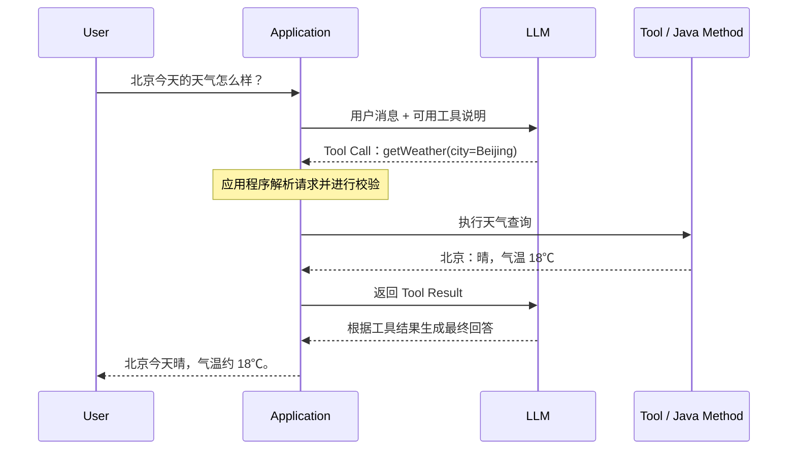

# Node 022：Tool Calling 是什么？

> 所属阶段：Phase 2 / Tool Calling 与 Agent Loop  
> 笔记类型：理论篇  
> 学习定位：理解 Tool Calling 的概念、参与角色和完整工作机制；本篇暂不实现 Java Tool Dispatcher，也不深入设计 Tool Schema。

---

## 一、本篇要解决什么问题？

在前面的学习中，我们已经能够让 Java 程序调用大模型 API：

```text
Java 程序
   │
   │ 发送 HTTP Request
   ▼
模型 Provider
   │
   ▼
LLM
   │
   │ 返回文本
   ▼
Java 程序
```

这种方式已经能完成很多任务，例如：

- 总结一段文本；
- 分类用户输入；
- 提取关键词；
- 按 JSON Schema 返回结构化结果；
- 进行多轮对话。

但它有一个明显限制：**模型主要是在生成内容，而不是直接操作我们的业务系统。**

例如，用户问：

> 帮我查询一下北京今天的天气。

如果我们只调用普通的模型对话接口，模型可能会根据已有知识生成一段天气描述。但它并没有因此真正访问天气服务，也没有真正查询实时天气。

再比如：

> 帮我查询订单 10086 的物流状态。

模型不能因为看到了这句话，就自动获得访问公司订单数据库或物流 API 的权限。

我们需要一种机制，让模型能够表达：

> 我需要使用某个工具，并且需要传入这些参数。

应用程序收到这个请求后，再由应用程序决定是否执行、如何执行，以及把结果如何交还给模型。

这个机制就是 **Tool Calling（工具调用）**。

---

## 二、Tool Calling 到底是什么？

Tool Calling 是一种让大模型能够请求应用程序使用外部工具的交互机制。

这里的“工具”可以是应用程序提供给模型使用的某项能力，例如：

- 查询天气；
- 查询订单；
- 查询数据库；
- 搜索网页；
- 计算数学表达式；
- 创建日程；
- 调用公司内部业务 API；
- 执行经过授权的业务操作。

关键是：**模型负责判断和提出工具调用请求，应用程序负责接收请求并执行实际操作。**

可以先记住这句话：

> Tool Calling 不是模型直接调用了 Java 方法，而是模型生成了一个结构化的工具调用请求，由应用程序负责解释和执行。

### 2.1 一个最简单的例子

假设我们的 Java 应用提供了一个天气查询能力：

```java
public String getWeather(String city) {
    // 实际项目中，这里可能会调用天气服务 API。
    return "北京：晴，气温 18℃";
}
```

用户问：

```text
北京今天的天气怎么样？
```

模型判断需要查询天气，于是返回一个工具调用请求。下面是一个**用于理解概念的简化示意**：

```json
{
  "name": "getWeather",
  "arguments": {
    "city": "Beijing"
  }
}
```

这段内容表达的是：

- `name`：希望使用的工具叫 `getWeather`；
- `arguments`：调用这个工具时需要传入的参数；
- `city`：参数名；
- `Beijing`：模型根据用户问题给出的参数值。

注意：这还不是天气查询结果，更不是 Java 方法已经执行的证明。它只是模型提出的调用请求。

接下来由应用程序解析请求，找到对应的工具，并在合适的权限和校验条件下执行：

```java
getWeather("Beijing");
```

应用程序拿到执行结果后，再把结果交还给模型。模型根据工具结果组织最终回答。

---

## 三、Tool Calling 中有哪些参与者？

先把整个机制中的角色分清楚。

### 3.1 User：用户

用户提出需求，例如：

```text
北京今天的天气怎么样？
```

用户通常不需要知道内部到底调用了哪个 Java 方法。

### 3.2 LLM：大语言模型

模型负责理解用户意图，并根据应用程序提供的工具信息判断：

- 当前任务是否需要工具；
- 如果需要，应该选择哪个工具；
- 调用工具时应该提供什么参数。

模型输出的是工具调用请求，而不是直接执行结果。

### 3.3 Tool：工具

Tool 是应用程序向模型描述的一项可用能力。

例如：

```text
工具名称：getWeather
工具用途：查询指定城市的天气
参数：city，城市名称
```

这里要注意：工具不等于某一个特定的 Java 类，也不等于某一个特定的框架组件。

从概念上说，Tool 是应用程序提供给模型使用的能力接口。后续我们会学习如何把这种能力描述成模型能够理解的 Tool Definition。

### 3.4 Application：应用程序

应用程序是整个过程中的执行方和控制方，通常负责：

- 把可用工具信息发送给模型；
- 接收模型返回的 Tool Call；
- 解析工具名称和参数；
- 检查工具是否存在、参数是否有效、当前操作是否被允许；
- 执行真正的 Java 方法或外部 API；
- 收集执行结果；
- 把工具结果交还给模型。

因此，应用程序并不是一个被动转发器。它掌握着工具执行的实际控制权。

### 3.5 Tool Result：工具执行结果

工具执行后会产生结果，例如：

```text
北京：晴，气温 18℃
```

这个结果由应用程序返回给模型。模型拿到结果后，才能基于这次查询的实际返回内容继续生成回答。

---

## 四、完整的 Tool Calling 工作流程

这是本篇最重要的部分。

假设用户问：

> 北京今天的天气怎么样？

完整流程可以分为以下步骤。

### 第一步：应用程序把工具说明提供给模型

应用程序在请求模型时，除了传递用户消息，还会提供当前可用工具的描述。

例如，应用程序告诉模型：

```text
你可以使用以下工具：

getWeather：查询指定城市的天气。
参数：city，城市名称。
```

模型由此知道当前有一个天气查询工具可供选择。

这里的工具说明不是 Java 方法的源码。模型不需要读取我们的 Java 类，也不会因为看到了工具名称就自动获得程序执行权限。

### 第二步：模型理解用户需求并决定是否请求工具

模型分析：

```text
用户想知道北京今天的天气。
当前提供了 getWeather 工具。
这个需求需要查询天气信息。
因此，我应该请求调用 getWeather。
```

模型返回 Tool Call 请求，其中包含工具名称和参数。

### 第三步：应用程序收到 Tool Call 请求

应用程序收到模型响应后，识别出：

```text
模型没有直接给出最终答案。
模型请求调用 getWeather。
参数是 city = Beijing。
```

此时应用程序还没有执行天气查询，只是收到了一个待处理的请求。

### 第四步：应用程序决定如何处理请求并执行工具

应用程序需要根据工具名称找到对应的实现，再根据业务规则处理参数。

例如：

```java
getWeather("Beijing");
```

真正访问天气服务、数据库或其他业务系统的，是应用程序中的代码。

实际工程中，不能不加检查地执行模型传来的任何内容。工具是否存在、参数是否正确、当前用户是否有权限、操作是否需要确认，都应该由应用程序控制。具体实现会在后续 Node 学习。

### 第五步：应用程序把工具结果交还给模型

假设工具返回：

```text
北京：晴，气温 18℃
```

应用程序把这次工具执行结果放入对话消息，再次请求模型。

这样模型就获得了本次工具调用的实际结果。

### 第六步：模型生成最终回答

模型根据工具结果回答：

```text
北京今天晴，气温约 18℃。
```

用户看到的是自然语言回答，而不是内部的 Tool Call 请求和 Java 方法调用过程。

### 4.1 用流程图串起来



请特别留意：**工具调用至少涉及一次模型请求和一次工具执行；工具结果通常还需要再次交给模型，才能形成面向用户的最终回答。**

---

## 五、模型到底有没有执行工具？

这是最容易混淆的地方。

假设模型返回：

```json
{
  "name": "getWeather",
  "arguments": {
    "city": "Beijing"
  }
}
```

这不代表：

```text
Java 方法已经执行。
```

它只代表：

```text
模型请求应用程序执行 getWeather，参数为 Beijing。
```

两者之间有本质区别。

### 5.1 模型负责提出请求

模型可以根据上下文选择工具、组织参数，但它并不天然拥有应用程序的运行环境。

它通常不知道：

- 你的 Java 对象在哪里；
- 你的数据库连接是什么；
- 你的服务端口是什么；
- 你的内部 API 如何认证；
- 某个用户是否有权限操作某条数据。

除非应用程序通过工具接口提供了相应能力，并在服务端实现了执行逻辑，否则模型不能凭空完成这些操作。

### 5.2 应用程序负责真正执行

应用程序可以选择：

- 接受并执行请求；
- 因参数不合法而拒绝；
- 因工具不存在而拒绝；
- 因用户没有权限而拒绝；
- 要求用户确认后再执行；
- 将执行失败的错误结果返回给模型。

所以，**模型提出请求，不等于应用程序必须执行。**

这也是为什么 Tool Calling 不只是一个模型参数或 Prompt 技巧，它还涉及应用程序的工程实现。

---

## 六、Tool Calling 与普通 Function Calling 有什么关系？

在很多模型 API 和开发文档中，你会看到：

- Tool Calling
- Function Calling
- Tools
- Function Tool

这些词经常出现在同一套机制中。

可以先这样理解：

- **Function Calling**：强调模型请求调用一个函数式能力；
- **Tool Calling**：更广义地强调模型请求使用某项工具能力。

在很多 API 中，函数是 Tool 的一种具体形式。比如天气查询可以包装成函数，也可以包装成其他工具接口。

因此，在当前学习路线中，我们统一使用 Tool Calling 这个名称。

不要把它理解成 Java 语言里的反射调用，也不要把它理解成模型直接运行了某段代码。

---

## 七、Tool Calling 和 Structured Output 有什么区别？

这两个概念都可能涉及结构化数据，但它们解决的问题不同。

### Structured Output：约束模型回答的数据结构

例如，我们让模型提取一段文本的情感：

```json
{
  "sentiment": "positive",
  "reason": "用户表达了满意"
}
```

重点是：

> 希望模型按照约定的数据结构返回结果，方便程序读取和处理。

### Tool Calling：让模型请求应用程序使用某项能力

例如：

```json
{
  "name": "getWeather",
  "arguments": {
    "city": "Beijing"
  }
}
```

重点是：

> 模型希望应用程序执行某个工具，并把执行结果交还给模型。

### 对比总结

| 对比项 | Structured Output | Tool Calling |
|---|---|---|
| 核心目的 | 结构化地返回数据 | 请求使用工具能力 |
| 模型输出 | 业务数据 | 工具名称和参数等调用信息 |
| 是否要求执行工具 | 不要求 | 需要应用程序处理调用请求 |
| 典型用途 | 分类、提取、生成 DTO 数据 | 查天气、查订单、调用业务 API |
| 应用程序职责 | 解析、校验和使用数据 | 解析请求、校验、执行工具、回传结果 |

一句话记忆：

```text
Structured Output：请按这个结构回答我。
Tool Calling：如果需要，请请求我帮你使用这个工具。
```

---

## 八、Tool Calling 和 Agent 是什么关系？

Tool Calling 是 Agent 的重要能力之一，但 **Tool Calling 本身不等于 Agent**。

一个普通的 Tool Calling 流程可能只有一次工具调用：

```text
用户提出问题
    ↓
模型请求工具
    ↓
应用程序执行工具
    ↓
模型生成回答
```

而 Agent 通常还需要围绕目标进行多轮决策和执行。

例如：

```text
用户：帮我分析北京今天的天气，并根据天气给出出行建议。

模型：先查询天气。
应用程序：执行天气查询并返回结果。
模型：根据天气结果，决定是否还需要查询空气质量。
应用程序：执行空气质量查询并返回结果。
模型：综合信息，生成出行建议。
```

这里可能发生多次：

```text
LLM 决策
   ↓
Tool Call
   ↓
应用程序执行
   ↓
Tool Result
   ↓
LLM 再次决策
```

当应用程序持续处理模型的工具调用请求、把执行结果交还给模型，并允许模型继续下一轮决策时，就出现了 Agent Loop 的基本形态。

可以先记住：

- Tool Calling 解决的是模型如何表达工具调用需求；
- Agent Loop 解决的是如何持续组织模型决策、工具执行和结果反馈；
- Agent 还涉及状态、上下文、停止条件、权限和可靠性等问题。

这些内容会在后续 Node 中逐步展开。本篇不提前深入实现 Agent Loop。

---

## 九、为什么 Tool Calling 对 Agent 如此重要？

普通 LLM 应用主要处理模型输入和输出。加入 Tool Calling 后，模型可以通过应用程序连接到真实系统。

这让模型的能力边界发生变化。

### 9.1 从生成信息到使用外部能力

没有工具时，模型主要根据输入上下文生成内容。

有工具后，模型可以请求应用程序：

- 获取实时信息；
- 查询业务数据；
- 调用已有服务；
- 执行经过授权的操作；
- 使用程序提供的计算能力。

### 9.2 把模型接入真实业务系统

假设我们以后做一个 Campaign Assistant，它可能需要：

```text
查询广告账户
查询 Campaign 数据
查询广告表现
暂停某个 Campaign
调整预算
```

这些能力本来就存在于业务系统或服务端代码中。Tool Calling 提供了模型与这些能力之间的一种交互方式。

但模型不能因为提出了“暂停 Campaign”的请求，就自动获得修改广告账户的权限。最终执行仍然必须经过应用程序的校验和控制。

### 9.3 Tool Calling 让 Agent 从“只会说”走向“能够做事”

这并不是说模型本身突然获得了执行能力，而是：

> 我们通过应用程序，把模型的决策能力与外部工具的执行能力连接了起来。

这是 Agent 工程中非常重要的一步。

---

## 十、几个必须避免的误解

### 误解 1：模型直接调用了 Java 方法

不准确。

模型生成的是 Tool Call 请求。真正调用 Java 方法的是应用程序。

### 误解 2：模型返回 Tool Call，就代表工具执行成功

不准确。

Tool Call 只是请求。执行可能失败，也可能被应用程序拒绝。

### 误解 3：只要给模型工具说明，它就一定会调用工具

不准确。

模型可能认为不需要工具，也可能选择其他工具，还可能生成不合适的参数。具体行为受模型、上下文、工具描述和 API 配置等因素影响。

### 误解 4：Tool Calling 就是 Agent

不准确。

Tool Calling 是 Agent 常用的工具交互机制之一。Agent 还需要组织循环、状态、上下文、停止条件等。

### 误解 5：模型可以调用任何它知道名字的工具

不准确。

模型只能请求应用程序实际提供并允许使用的工具。工具是否可用、是否允许执行，由应用程序控制。

### 误解 6：工具参数是模型生成的，所以可以直接信任

不准确。

模型生成的参数仍然需要程序校验。模型可能遗漏参数、误解用户意图，或者给出不符合业务规则的值。

---

## 十一、本篇知识总结

### 11.1 一句话定义

**Tool Calling 是一种模型向应用程序提出结构化工具调用请求、由应用程序负责实际执行并把结果反馈给模型的交互机制。**

### 11.2 必须记住的调用链

```text
用户提出需求
    ↓
应用程序提供工具说明
    ↓
模型理解需求并选择工具
    ↓
模型返回 Tool Call 请求
    ↓
应用程序解析、校验并执行工具
    ↓
应用程序获得 Tool Result
    ↓
应用程序把结果交还模型
    ↓
模型生成最终回答
```

### 11.3 必须记住的职责边界

| 角色 | 主要职责 |
|---|---|
| User | 提出需求 |
| LLM | 理解意图、选择工具、生成调用请求 |
| Application | 控制调用流程、解析请求、校验并执行 |
| Tool | 提供具体能力 |
| Tool Result | 把执行结果反馈给模型 |

### 11.4 本篇最重要的结论

```text
LLM 不直接执行 Java 方法。
LLM 生成 Tool Call 请求。
Application 负责真正执行工具。
Tool Result 再返回给 LLM。
```

---

## 十二、自测：确认自己是否真正理解

建议先不看前面的正文，尝试自己回答。

### 问题 1

Tool Calling 是什么？它解决了普通 LLM 对话中的什么问题？

### 问题 2

模型返回了 `getWeather(city=Beijing)`，是否意味着 Java 方法已经执行？为什么？

### 问题 3

Tool Calling 中，LLM 和 Application 分别负责什么？

### 问题 4

为什么应用程序不能无条件执行模型返回的所有 Tool Call？

### 问题 5

Structured Output 和 Tool Calling 的核心区别是什么？

### 问题 6

Tool Calling 和 Agent Loop 是什么关系？为什么 Tool Calling 不等于 Agent？

### 问题 7

如果工具执行失败，模型是否一定知道？应用程序需要做什么，模型才能根据失败结果继续处理？

---

## 十三、完成标准

完成本 Node 的理论学习后，应当能够做到：

- [ ] 不看笔记，能够用自己的话解释 Tool Calling。
- [ ] 能够区分模型提出工具调用请求与应用程序真正执行工具。
- [ ] 能够按顺序讲清楚一次完整 Tool Calling 的工作流程。
- [ ] 能够说清楚 LLM、Application、Tool 和 Tool Result 的职责。
- [ ] 能够区分 Structured Output 与 Tool Calling。
- [ ] 能够解释 Tool Calling 为什么是 Agent 的重要能力，但不等于 Agent。
- [ ] 能够指出模型生成的工具参数为什么仍然需要应用程序校验。

**达到以上标准，再进入下一个 Node。**

---

## 十四、与后续 Node 的边界

本篇只建立 Tool Calling 的整体认知，不要求现在就实现完整工具调用系统。

后续会逐步拆解：

| 后续节点 | 将要深入的问题 |
|---|---|
| Node 023：Tool Definition | 应该怎样向模型描述一个工具？ |
| Node 024：参数 Schema | 工具参数怎样描述、约束？ |
| Node 025：Tool Dispatcher | 应用程序怎样根据工具名称找到对应实现？ |
| Node 026：第一次完整 Tool Call | 怎样把模型请求、Java 执行和结果回传真正串起来？ |
| Node 027～035 | 多工具、校验、错误、权限、人工确认和幂等性等工程问题 |
| Node 036～041 | Agent Loop、停止条件、循环风险、并行调用和工具上下文等 |

因此，本篇结束时，**不需要提前实现 Tool Dispatcher，不需要接入多个工具，也不需要实现 Agent Loop**。这些都属于后续节点的学习内容。

---

## 学习记录

- 理论阅读日期：待填写
- 自测情况：待填写
- 尚未理解的问题：待填写
- 是否达到完成标准：待确认

